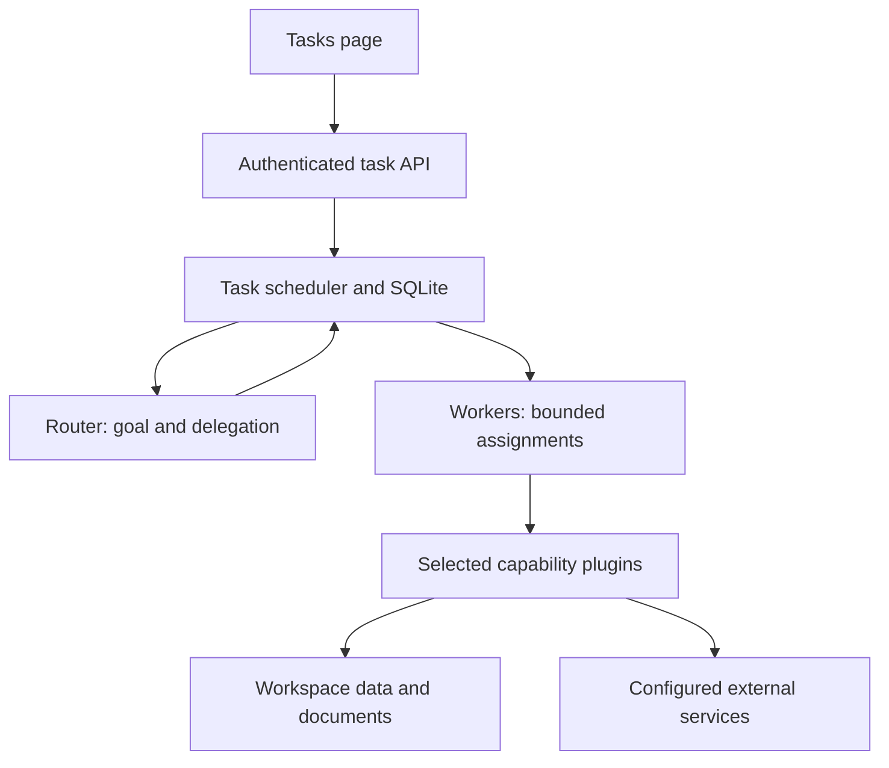

# Legacy Tasks runtime (historical UI documentation)

The branch-only `/tasks` page and its browser test have been retired. The `.mjs`
API described here remains for existing clients. For the current main UI connected
to the isolated TypeScript backend, see [v1 setup and verification](verification-v1-ui/REPORT.md).
UI instructions below describe the former interface.

The **Tasks** page at `/tasks` is a new execution path for work that needs
delegation, follow-up instructions, waiting, or recovery after a server restart.
It uses the existing React frontend, Node server, owner authentication, workspace
data, and DeepSeek configuration. Existing Threads and `/api/runs` continue to use
their existing runtime; opening a thread does not silently migrate it into a task.

The design takes inspiration from the separation of routing, execution, durable
events, and tool capabilities in
[DeepSeek's Super-agent prototype](https://github.com/deepseek-ai/dsh-superagent-prototype).
This is an independent implementation for Hyperagents. It does not require DSH or
claim compatibility with its plugin binaries or deployment environment.

## Use it

1. Use Node 24+, run `npm ci` and `npm run dev`, and complete owner setup if this is
   a new installation.
2. Configure `DEEPSEEK_API_KEY` in the private server environment as described in
   [DEEPSEEK.md](DEEPSEEK.md). Tasks shares the existing model catalog and key.
3. Open **Tasks** in the sidebar. Choose a model, the available plugins, and
   optionally a saved Agent. Enter the actual goal and start the task.
4. Read the task result and activity, or open a child task to inspect its work.
   Add a follow-up while the task is running or waiting. An unanswered question
   and a pending approval remain available after a page refresh or server restart.
5. Use **Prompts** to edit the Router or Worker instructions for this workspace.
   Save and restore-default operations use version checks so a stale tab cannot
   silently overwrite another edit.

For example: “Find the documents relevant to our onboarding flow, compare the
current frontend and backend requirements, and save an implementation proposal.”
Select Workspace and Documents; select Web search only if outside sources are
needed. A plugin must be registered and configured on the server before it can be
selected. The page does not offer unavailable capabilities as working tools.

Tasks requires the real backend. Fixture mode does not manufacture task results.
Without a configured model, the page explains the missing setup and task creation
returns an explicit error.

## Responsibility boundaries



| Component | Responsibility | Source |
| --- | --- | --- |
| Task runtime | Durable state, input delivery, scheduling, tool intents/results, approvals and recovery | `server/task-runtime.mjs` |
| Model adapter | DeepSeek streaming, validated tool calls, cancellation and provider-specific private messages | `server/agent-model.mjs` |
| Plugin host | Registration, schemas, per-task binding, capability intersection and cleanup | `server/agent-plugins.mjs` |
| Prompt assembly | Built-in files, workspace overrides, goal and selected Agent guidance | `server/agent-prompts.mjs`, `prompts/agent/` |
| HTTP integration | Existing authentication, workspace scope and artifact persistence | `server/app.mjs` |
| Current UI | Original conversations and artifact panel connected to backend v1 | `src/V1Thread.tsx`, `src/v1-client.ts` |

The kernel has no built-in browser session, shell, email sender, or filesystem
executor. Such capabilities can be added through trusted server plugins. Browser
work is deliberately outside this implementation. The existing thread tool menu
and integration catalog are not automatically exposed to Tasks.

### Router and workers

A new user goal creates a **Router** task. It can answer a simple question directly
or delegate independent assignments to Workers. Its callable tools are:

| Tool | Behavior |
| --- | --- |
| `delegate_task` | Create a direct worker with a self-contained brief and a subset of the parent's plugins; an identical brief/Agent/plugin selection reuses the existing child. |
| `send_task_input` | Add a correction to a direct child, including a child awaiting approval; superseded, unexecuted proposals are cancelled. |
| `list_task_children` | Read actual child states and short result previews. |
| `read_task_result` | Read one direct child's result with `offset`/`limit` pagination. |
| `wait_for_tasks` | Release the Router slot until its children complete. |
| `request_user_input` | Persist a concrete question and release the execution slot. |

Workers receive only their selected, authorized plugin tools and
`request_user_input`. They cannot recursively spawn more workers. The Router does
not execute external plugin tools itself. A selected saved Agent supplies guidance
and an additional capability restriction; its tool permissions are checked again
before each execution.

The default scheduling capacity is **one Router plus two Workers**. Waiting for
children, an answer, or approval does not occupy a model execution slot. Independent
workers can proceed concurrently. Child completion is recorded as an input for its
parent, and the parent resumes once its current children have finished. A user can
still send the parent a new instruction while it is waiting.

The initial scope is one Router with up to eight direct Workers. Defaults are 32
model steps and 128 tool calls per task, with a two-minute deadline per model/tool
operation. An explicit retry gives a failed task another bounded execution budget
without deleting its history. These are server runtime options, not permissions
the model can change.

## Durable execution and recovery

The runtime stores `tasks.sqlite` beside the existing `workspace.sqlite` in the
configured data directory. Its tables hold task goals and private model history,
versioned prompts, input receipts, activity events, activation attempts, and tool
effects. Closing the page does not cancel a task. Stop the service before backing
up the whole data directory, including its SQLite files and uploaded bytes.

An exclusive SQLite transaction in `tasks.scheduler.sqlite` permits one scheduler
per data directory; `tasks.lock` records diagnostic owner metadata. A second live
process is rejected, and process death releases the operating system lock. The
scheduler lock database remains on disk and must not be deleted while the service
is running. Future or unrelated
database schemas are refused before initialization changes them. This is a
single-process scheduler, not a distributed queue or a multi-host lease protocol.

### Checkpoints

1. A model step reads a persisted conversation and consumes a bounded batch of
   pending inputs in one transaction. Follow-ups arriving during that model call
   are retained for its next step; unstarted tool proposals based on the old
   instruction are retired before that next step, with paired cancellation results.
2. The assistant's tool-call message and its effect records are committed together
   **before** a tool executes.
3. Each result and its matching tool response are committed together. A resumed
   task completes outstanding tool responses before appending new user messages.
4. A final answer succeeds only after needed child tasks have reached terminal
   states and there are no unconsumed inputs. A failed child remains visible to
   the Router so it can explain or recover the failure.

`request_user_input` and a yielding `wait_for_tasks` end the current execution
batch. Any later tool calls in that same batch are cancelled with explicit tool
responses. The model must reconsider them after the answer or child results arrive.

| State | Meaning / next action |
| --- | --- |
| `queued`, `running` | Ready for execution or currently executing a step. |
| `waiting_children` | Parent yielded; child completion or new user input can resume it. |
| `waiting_input` | A question is saved; answer in the task page to resume. |
| `waiting_approval` | A specific write proposal awaits approve/deny. |
| `blocked` | A write has an unknown outcome; inspect the destination and provide a follow-up with the observed result. |
| `succeeded` | Current work is complete; a new follow-up can reopen it. |
| `failed` | A concrete error or execution/context budget stopped work; review and retry, or start a focused follow-up task. |
| `cancelled` | Terminal cancellation; create a new task to start again. Cancelling a parent cancels its outstanding descendants. |

### Effect semantics

Each plugin tool declares an effect type and replay policy. On recovery:

- **Safe effects** can be repeated when their completion was not recorded. Reads
  default to safe replay. A write may declare safe replay only if its destination
  is idempotent under the stable `effectId`.
- **Manual effects** that started without a recorded result become `unknown` and
  block the task. They are not automatically replayed. The Retry action refuses
  to bypass this state.
- A new user or parent instruction retires unexecuted proposals and adds an
  explicit unknown-result observation for any interrupted manual write. It does
  not claim that write failed or undo a side effect already performed.

Approval applies to the persisted tool name and exact arguments. Tool registration,
scope, effect/replay metadata, and stricter approval requirements are checked again
at execution time. A changed or removed capability does not inherit old approval.

Cancellation uses `AbortSignal` and releases the scheduler even if an adapter does
not settle promptly. Cleanup has a bounded wait. JavaScript plugins run in the
trusted server process: an adapter that ignores cancellation may still complete an
external action. This interface is not an isolation sandbox and does not promise
exactly-once delivery to arbitrary remote APIs.

The built-in Documents plugin uses the effect ID to derive a stable artifact ID.
Saving the same effect after a crash returns the existing matching document.
A conflicting edit is reported instead of overwriting it.

## Plugins

Included plugins are:

| Plugin ID | Available tools and configuration |
| --- | --- |
| `workspace-read` | Search/read existing workspace resources. Selected Agent permissions can narrow these readers; broad workspace readers are excluded for a restricted Agent. |
| `web-search` | Reuses the existing Exa adapter when configured, otherwise keyless Bing RSS; adds scholarly search when OpenAlex is configured. Upstream availability still applies. |
| `documents` | `task_save_document` creates a real Document artifact in the current workspace. It is an idempotent local write and does not require an extra approval for each save. |

Plugin registration is a trusted server operation. No HTTP request can submit a
JavaScript module, package name, executable path, or new tool definition. The UI
only selects IDs already registered by the server.

```js
const plugin = {
  id: 'example-service',
  name: 'Example service',
  description: 'What this configured capability can actually do.',
  available: true,
  defaultEnabled: false,
  tools: [{
    definition: { type: 'function', function: {
      name: 'example_lookup',
      description: 'Read one record by ID.',
      parameters: {
        type: 'object',
        properties: { id: { type: 'string', minLength: 1, maxLength: 100 } },
        required: ['id'],
        additionalProperties: false,
      },
    } },
    effect: 'read-only',
    replay: 'safe',
    approvalRequired: false,
    capability: 'example-service',
  }],
  bind({ workspaceId, taskId, agentId, capabilities }) {
    return {
      async execute(name, args, { signal, effectId }) {
        // Call your configured service here. Respect workspace scope and signal.
        // For a safe write, pass effectId as the destination's idempotency key.
        return service.lookup({ workspaceId, id: args.id, signal });
      },
      async close() { /* release this binding's owned resources */ },
    };
  },
};
```

The service in this example is supplied by the application; it is not a global
provided by Hyperagents. A complete dependency-free example is
[`examples/agent-plugins/text-analysis.mjs`](../examples/agent-plugins/text-analysis.mjs).
To enable it, import `textAnalysisPlugin` in the server bootstrap and pass
`agentPlugins: [textAnalysisPlugin]` to `createApp`. It then appears as a selectable
plugin for new tasks. Use the default worker or a saved Agent with the declared
capability.

`bind` is synchronous; `execute` and `close` may be asynchronous. Each activation
gets a binding and closes it when yielding or completing. Return JSON-serializable
tool results. A plugin must not retain authority or user data from another task's
binding. Tool names must be unique and cannot shadow the kernel tools.

Writes default to `replay: 'manual'` and `approvalRequired: true`. Reads default to
`replay: 'safe'`. A custom tool without `capability` uses its plugin ID as the saved
Agent capability label. With no selected Agent, the task's explicitly selected
plugins define its capability set; a child can only narrow that set.

To swap the model without changing the scheduler, supply a `taskModel` to
`createApp`: `{ configured, models, step({model,messages,tools,signal,onDelta}) }`.
`step` returns `{text, toolCalls, assistantMessage?, usage?}` where each tool call is
`{id,name,arguments}` and `arguments` is a JSON object. `assistantMessage` is private
provider state; public events contain visible answer text and tool results, not
the provider's internal reasoning.

## Built-in prompts

The prompt files are ordinary, version-controlled source:

- `prompts/agent/router.md`: preserve the user's goal, delegate complete briefs,
  route corrections, wait without polling, and reconcile real child results.
- `prompts/agent/worker.md`: complete a bounded assignment using only its actual
  tools, distinguish observations from assumptions, and report useful evidence.
- `prompts/agent/recovery.md`: recover from saved facts and check uncertain writes
  before deciding what to do next.

The workspace editor replaces the Router or Worker base text in full. Runtime
facts, the goal, selected Agent guidance, and plugin descriptions are assembled
around it. Editing a prompt cannot grant a tool or remove an approval requirement.

Each task snapshots its assembled system prompt at creation and exposes the hash
of its base prompt version. Editing or restoring defaults changes **new tasks**;
existing tasks retain their snapshot on restart or retry. A new child created
later snapshots the Worker prompt current at its own creation. The recovery prompt
is supplied by the running server version when recovery is requested.

## HTTP API

All endpoints use the existing owner session, trusted-origin/CSRF checks, and
explicit `workspaceId` scope. Mutation bodies reject unknown fields. They cannot
set a task's role, parent, completion status, effect result, or approval metadata.

| Method and route | Request / response |
| --- | --- |
| `GET /api/agent-runtime?workspaceId=...` | Configured model state, available plugins, current prompts and budgets. |
| `PUT /api/agent-prompts/router` or `/worker` | `{workspaceId, content, revision}`; `content: null` restores the built-in text. |
| `GET /api/tasks?workspaceId=...` | Latest 200 tasks for this workspace. |
| `POST /api/tasks` | `{workspaceId, text, requestId, pluginIds?, model?, agentId?}`; returns `{task}` with HTTP 202. |
| `GET /api/tasks/:id?workspaceId=...` | Task, children, latest 100 input receipts and 200 activity events. |
| `POST /api/tasks/:id/inputs` | `{workspaceId, text, requestId}`; returns task and input receipt. |
| `POST /api/tasks/:id/cancel` or `/retry` | `{workspaceId}`; returns `{task}`. |
| `POST /api/tasks/:id/approvals/:effectId` | `{workspaceId, decision: 'approve' \| 'deny'}`; URL-encode the effect ID. |

Use a stable request ID when retrying a lost HTTP response. Reusing it with
different content returns a conflict. After a confirmed success, an intentionally
new task or follow-up gets a new ID. HTTP 202 confirms durable admission, not a
completed model call. The frontend polls state and uses persisted events for
visible progress; this path does not require an open streaming HTTP connection.

## Validation and current limits

Focused tests cover the model adapter, plugin host, prompts, durable runtime and
HTTP API:

```sh
npm run test:tasks
npm run typecheck
npm run build
npm run test:backend
```

Runtime tests use temporary SQLite databases and controlled models. They include
real child-process `SIGKILL` recovery, safe-read replay, manual-write uncertainty,
input delivery during an active model call, parent/child correction, yield and
approval behavior, scoped authorization, prompt conflicts, and request deduplication.
The API integration also uses the actual Documents plugin and workspace persistence
to verify a saved artifact survives restart without duplication. No live DeepSeek
or public search result is asserted by these deterministic tests.

The Tasks browser suite builds the app and starts a real API with temporary SQLite
storage and controlled model/plugin adapters. It covers creation, waiting for an
answer, follow-ups, child navigation, approval, cancellation, retry, prompt editing,
reload persistence, and desktop/mobile layout. Install Playwright Chromium first
with `npx playwright install chromium`. An existing browser can be selected using
`TASK_UI_BROWSER_EXECUTABLE`; optional `TASK_UI_BROWSER_ARGS` is a JSON string array.
Screenshots go to ignored `test-results/tasks-ui` by default.

It also verifies the actual Documents plugin saves an artifact, Tasks refreshes
the workspace without losing an unsent input, and the artifact can immediately
be opened and edited in Library without a full-page reload or a stale revision.

This version provides persistent conversations with explicit budgets, not automatic
context compaction or a long-term memory engine. Context over 240,000 serialized
characters stops with an actionable error. Tool output is bounded in model history
and activity; private stored effect results are capped at 128,000 characters. There
is no scheduled watchdog, webhook source adapter, distributed worker pool, arbitrary
plugin installation, or browser capability in the new task kernel. These can be
added as separate capabilities without changing the task page's core lifecycle.
